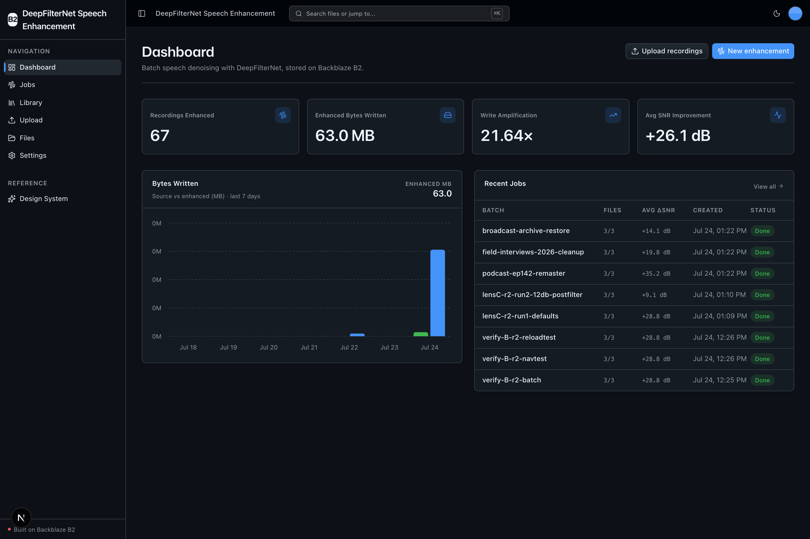
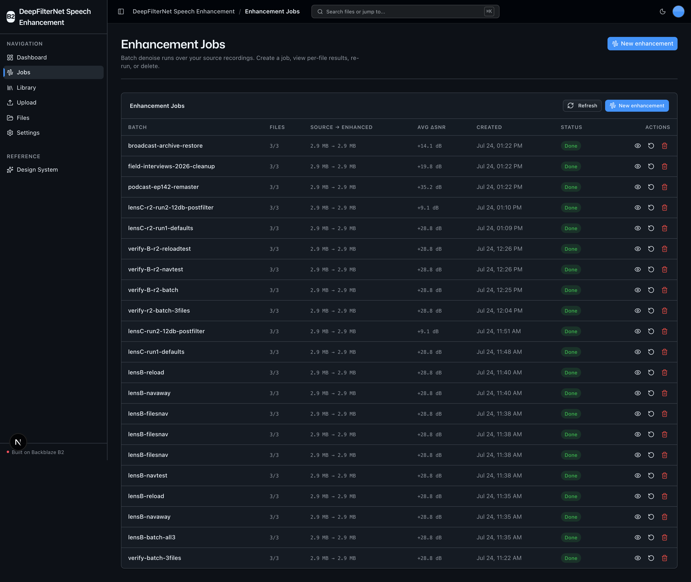
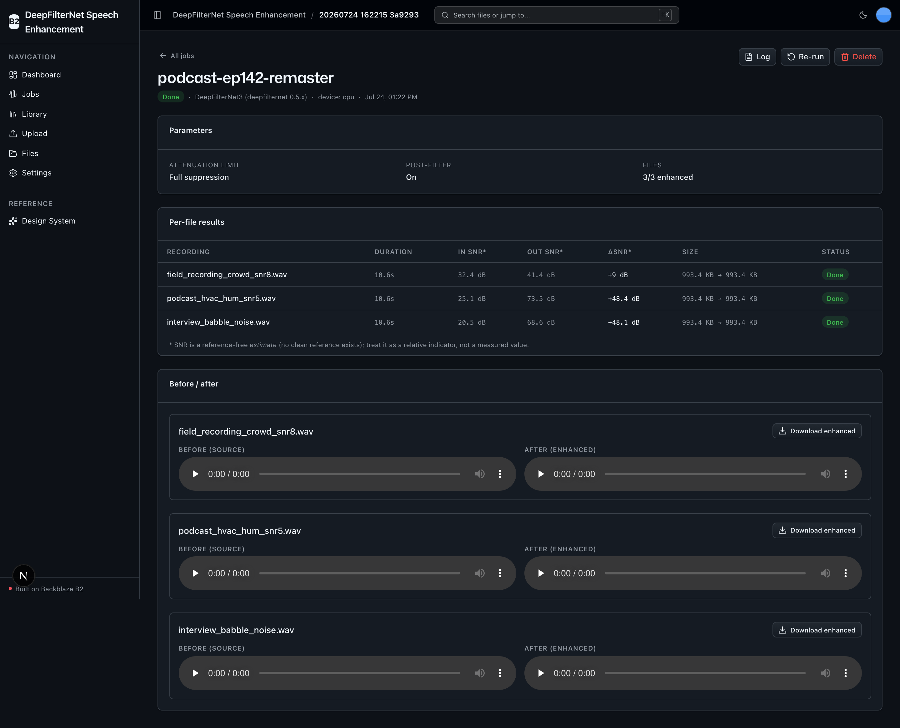
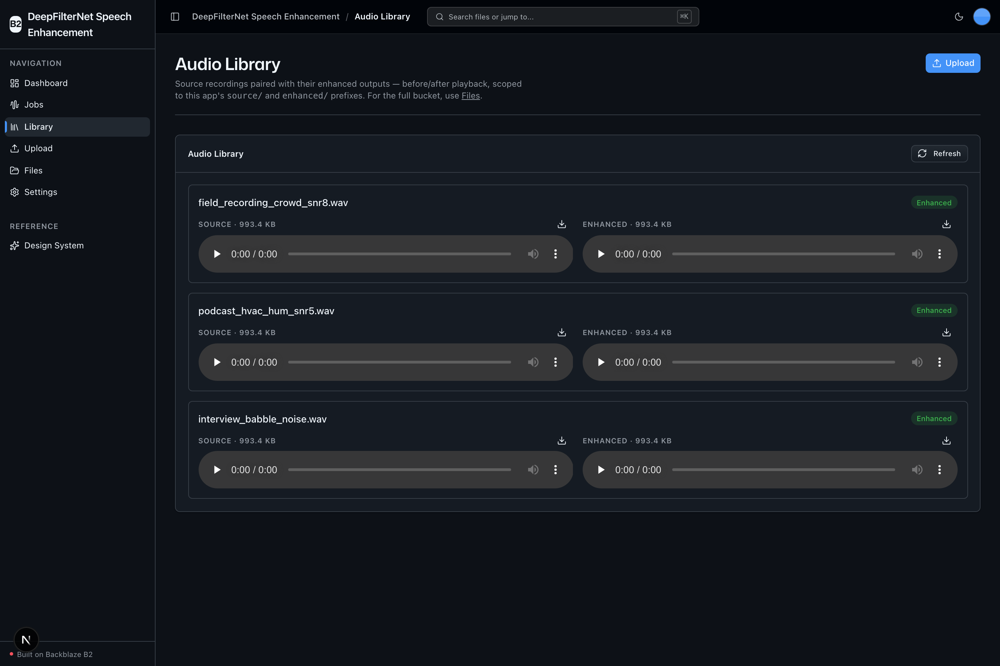
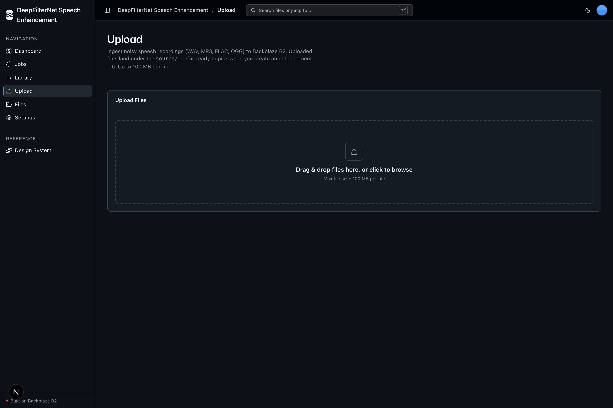

<!-- last_verified: 2026-07-24 -->
# DeepFilterNet Speech Enhancement

Batch **speech denoising / enhancement** on your own machine, with every artifact
stored on **[Backblaze B2](https://www.backblaze.com/cloud-storage?utm_source=github&utm_medium=referral&utm_campaign=ai_artifacts&utm_content=b2ai-deepfilternet-batch-speech-enhancement)**.
Point it at noisy speech recordings (WAV/MP3/FLAC/OGG, 8–48 kHz), and
[DeepFilterNet](https://github.com/Rikorose/DeepFilterNet) — a local deep-filtering
neural network — cleans each one and writes the enhanced **48 kHz WAV** back to B2
under an `enhanced/` prefix, alongside a per-batch **JSONL processing log**. Runs on
**B2 credentials only — no second API key.**

Built for podcast studios, broadcast archives, and speech-dataset curators who need a
reproducible, auditable denoise step that downstream transcription / TTS / distribution
jobs can read straight from object storage over the S3 API.

## What it looks like

**Dashboard** — denoising metrics (recordings enhanced, enhanced bytes written, write-amplification ratio, average SNR improvement), a 7-day bytes-written chart, and recent jobs.



**Enhancement Jobs** — every batch denoise run with file counts, source-to-enhanced size, average SNR gain, status, and re-run / delete actions.



**Job detail** — per-file SNR results and before/after players for one batch, each with an enhanced-WAV download.



**Audio Library** — source recordings paired with their enhanced outputs for before/after playback, streamed straight from B2.



**Upload** — drag-and-drop ingest of noisy recordings to the B2 `source/` prefix, ready to pick when creating a job.



## The B2 story: write amplification

A compressed-MP3 archive produces an equal-or-**larger** set of *uncompressed* 48 kHz
WAV outputs, plus JSONL logs — so total stored bytes grow with every batch. The
dashboard makes that ratio (`enhanced_bytes / source_bytes`) the hero metric. This is
exactly the kind of durable, growing, AI-generated dataset that object storage like B2
is built for.

## What you get

- **Batch speech enhancement** — DeepFilterNet3, on-device, ~$0 per run (local compute).
- **Enhanced outputs + audit log on B2** — cleaned 48 kHz WAV to `enhanced/`, a JSONL
  log per batch to `jobs/` (input key, output key, model version, timestamp, SNR estimate).
- **Enhancement Jobs** — create / view / re-run / delete batch denoise runs.
- **Audio Library** — before/after playback of source vs enhanced, streamed from B2.
- **Denoising dashboard** — recordings enhanced, enhanced bytes written, write-amplification
  ratio, average SNR improvement.
- **B2 bucket explorer + upload** — the retained starter surface: full-bucket browse and
  audio ingest.

## Architecture at a glance

- `apps/web/` — Next.js 16 + React 19 + Tailwind v4 + shadcn/ui frontend.
- `services/api/` — FastAPI backend, strictly layered `types → config → repo → service → runtime`.
- The DeepFilterNet model + audio decode live **only** in `services/api/app/repo/denoiser.py`
  (external-SDK-in-repo rule, mirroring how boto3 is confined to `repo/`).
- B2 is the sole data store — no database. Prefixes: `source/` (ingested originals),
  `enhanced/` (cleaned WAVs), `jobs/` (per-batch JSONL logs).

Full detail: [AGENTS.md](AGENTS.md) and [ARCHITECTURE.md](ARCHITECTURE.md).

## Quick Start

You need: Node.js >= 20, pnpm >= 9, Python >= 3.11, and a free
**[Backblaze B2 account](https://www.backblaze.com/sign-up/ai-cloud-storage?utm_source=github&utm_medium=referral&utm_campaign=ai_artifacts&utm_content=b2ai-deepfilternet-batch-speech-enhancement)**.

**1. Install frontend dependencies**

```bash
pnpm install
```

**2. Set up the backend**

```bash
cd services/api
python3 -m venv .venv && source .venv/bin/activate
pip install -r requirements.txt
cd ../..
```

> The first enhancement run downloads the pretrained DeepFilterNet3 weights (a few MB)
> into the DeepFilterNet cache dir. `torch`/`torchaudio` are sizable — the first
> `pip install` can take a couple of minutes.

**3. Add your B2 credentials**

```bash
cp .env.example .env
```

Open `.env` and, from the
[Backblaze B2 dashboard](https://secure.backblaze.com/b2_buckets.htm?utm_source=github&utm_medium=referral&utm_campaign=ai_artifacts&utm_content=b2ai-deepfilternet-batch-speech-enhancement):

1. **Create a bucket** → paste its **Bucket Unique Name** into `B2_BUCKET_NAME`, and the
   **region slug** (e.g. `us-west-004`, from the endpoint) into `B2_REGION`. The S3
   endpoint is derived as `https://s3.<region>.backblazeb2.com` — do not paste a full URL.
2. **Create an application key** with `Read and Write` → paste **keyID** into
   `B2_APPLICATION_KEY_ID` and **applicationKey** into `B2_APPLICATION_KEY` *(shown once)*.

`B2_PUBLIC_URL_BASE` is optional (only for public buckets); leave it unset and the app
streams audio via presigned URLs.

**4. Run it**

```bash
pnpm dev
```

Frontend at `localhost:3000`, API at `localhost:8000` (Swagger UI at `/docs`). `pnpm dev`
runs `pnpm doctor` first — a preflight that catches the common setup gotchas (wrong
Node/Python version, missing venv, missing/placeholder `.env`, busy ports).

## Try it end to end

1. **Upload** a noisy speech recording on `/upload` — it lands under `source/`.
   Need a sample? Any short noisy WAV/MP3 works; e.g. grab a clip from a
   Creative-Commons source such as [Freesound](https://freesound.org) or record a few
   seconds with background noise. (No audio is bundled with this repo.)
2. **Create a job** on `/jobs/new` — pick one or more recordings, choose an attenuation
   limit, and run.
3. **Listen** on the job detail page or `/library` — before/after players stream straight
   from B2. Download the enhanced WAV or the JSONL log.
4. Watch the **dashboard** write-amplification ratio climb as outputs accumulate.

## GPU / device

Device is auto-detected: **CUDA if available, else CPU** (never a hard GPU requirement).
Apple MPS is deliberately skipped — DeepFilterNet's complex-valued DSP ops have
incomplete MPS coverage — so on a Mac it runs on CPU. CPU denoising is real-time-ish for
short clips; long batches take proportionally longer.

## Tech Stack

- TypeScript, Next.js 16, React 19, Tailwind v4, shadcn/ui, Recharts, TanStack Query
- Python 3.11+, FastAPI, boto3, Pydantic v2
- **DeepFilterNet** (`deepfilternet`, import `df`), PyTorch/torchaudio, soundfile, librosa
- Backblaze B2 (S3-compatible object storage)
- pnpm workspaces (monorepo)

## Commands

| Command | What it does |
|---------|-------------|
| `pnpm dev` | Start frontend + backend |
| `pnpm dev:web` / `pnpm dev:api` | One side only |
| `pnpm build` | Build frontend |
| `pnpm lint` / `pnpm lint:api` | Lint frontend / backend (ruff) |
| `pnpm test:web` / `pnpm test:api` | Unit tests |
| `pnpm check:structure` | Verify layering + SDK-containment rules |
| `pnpm test:e2e` | Playwright e2e (`pnpm --filter @deepfilternet-batch-speech-enhancement/web exec playwright install chromium` once first) |

## Documentation Map

| Doc | Purpose |
|-----|---------|
| [AGENTS.md](AGENTS.md) | Agent table of contents — start here |
| [ARCHITECTURE.md](ARCHITECTURE.md) | System layout, layering, data flows, prefixes |
| [docs/features/](docs/features/) | Feature docs (enhancement, jobs, library, dashboard, upload, browser) |
| [docs/app-workflows.md](docs/app-workflows.md) | User journeys |
| [docs/SECURITY.md](docs/SECURITY.md) · [docs/RELIABILITY.md](docs/RELIABILITY.md) | Security & reliability |
| [docs/exec-plans/](docs/exec-plans/) | Execution plans and tech debt tracker |

## License

MIT License — see [LICENSE](LICENSE).

## Claude Agent B2 Skill

Manage Backblaze B2 from your terminal using natural language (list/search, audits, stale
or large file detection, security checks, safe cleanup).
Repo: [https://github.com/backblaze-b2-samples/claude-skill-b2-cloud-storage](https://github.com/backblaze-b2-samples/claude-skill-b2-cloud-storage)
